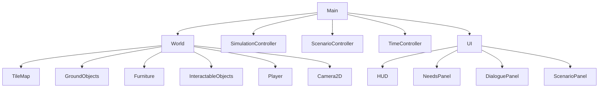
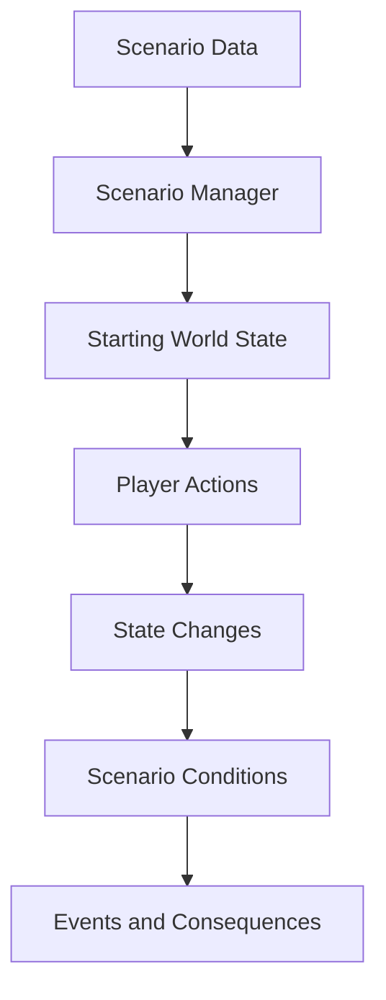

# Finanpolis

Project directory for **Finanpolis**, a life simulation game focused on financial education.

## Basic Life-Sim Architecture

```mermaid
graph TD
    Game --> Main
    Game --> Simulation
    Game --> Scenarios
    Game --> Interface

    Main --> GameManager
    Main --> ScenarioManager
    Main --> TimeManager
    Main --> SaveManager

    Simulation --> World
    Simulation --> Player
    Simulation --> Time
    Simulation --> State

    World --> IsometricGrid
    World --> TileMap
    World --> Furniture
    World --> InteractableObjects
    World --> Characters

    Player --> Movement
    Player --> Needs
    Player --> Inventory
    Player --> Relationships
    Player --> Actions

    Time --> Day
    Time --> Schedule
    Time --> Events

    State --> PlayerState
    State --> WorldState
    State --> RelationshipState
    State --> ScenarioState

    Scenarios --> ScenarioDefinition
    Scenarios --> ScenarioLoader
    Scenarios --> ScenarioContext
    Scenarios --> ScenarioObjectives
    Scenarios --> ScenarioConsequences

    Interface --> HUD
    Interface --> NeedsPanel
    Interface --> InventoryPanel
    Interface --> DialoguePanel
    Interface --> ScenarioPanel
    Interface --> CalendarPanel
```



## Generic Scene Structure



The architecture will be further modified to maintain consistency with the GDD.

## Building Steps

### Build the Game in This Order

1. Create the main scene.
2. Add an isometric `TileMap`.
3. Add player movement using grid-based or world coordinates.
4. Add a camera that follows the player.
5. Create one interactable object, such as a bed.
6. Add a basic interaction system.
7. Add a simple time manager.
8. Add one player need, such as energy.
9. Display the player's needs and the current time in the UI.
10. Add save and load functionality only after the core gameplay loop is working.

### Minimal First Implementation

```text
Scenes/
├── main.tscn
├── world.tscn
├── player.tscn
└── interactable_object.tscn

Scripts/
├── main.gd
├── world.gd
├── player.gd
├── interaction_system.gd
├── time_manager.gd
└── utilities/
    ├── grid_utils.gd
    └── coordinate_utils.gd

Assets/
├── art/
│   ├── sprites/
│   └── tilesets/
├── audio/
└── fonts/

Data/
```

Start with placeholder graphics. Use simple colored shapes or basic tiles instead of final artwork. The goal of this first step is to prove that movement, interaction, time, and state changes work together.

## Scenario Architecture

Once the core gameplay loop is working, add the scenario architecture:



Do not begin by creating many scenarios, characters, objects, or UI screens. First, make one complete interaction work from beginning to end. That interaction will become the foundation for the rest of the game.

## Project Folder Structure

The project is organized into separate folders for assets, scenes, scripts, and game data.

### `Assets/`

Contains the visual, audio, and font resources used throughout the game.

#### `Assets/art/`

Contains the game's artwork and visual resources.

#### `Assets/art/sprites/`

Contains sprites for characters, enemies, objects, items, effects, and other 2D game elements.

#### `Assets/art/tilesets/`

Contains tiles and tileset resources used to create the isometric game world and its environments.

#### `Assets/audio/`

Contains music, sound effects, ambient sounds, and other audio resources used in the game.

#### `Assets/fonts/`

Contains the fonts used for the game's user interface, menus, dialogue, and other text elements.

### `Scenes/`

Contains Godot scene files that define the structure, components, and reusable elements of the game.

### `Scripts/`

Contains the GDScript files responsible for controlling game logic, mechanics, systems, and behaviors.

#### `Scripts/utilities/`

Contains reusable helper scripts and general-purpose functions shared across different parts of the game.

### `Data/`

Contains configuration files and structured game data, such as item information, scenario settings, quests, dialogue, and other gameplay-related resources.